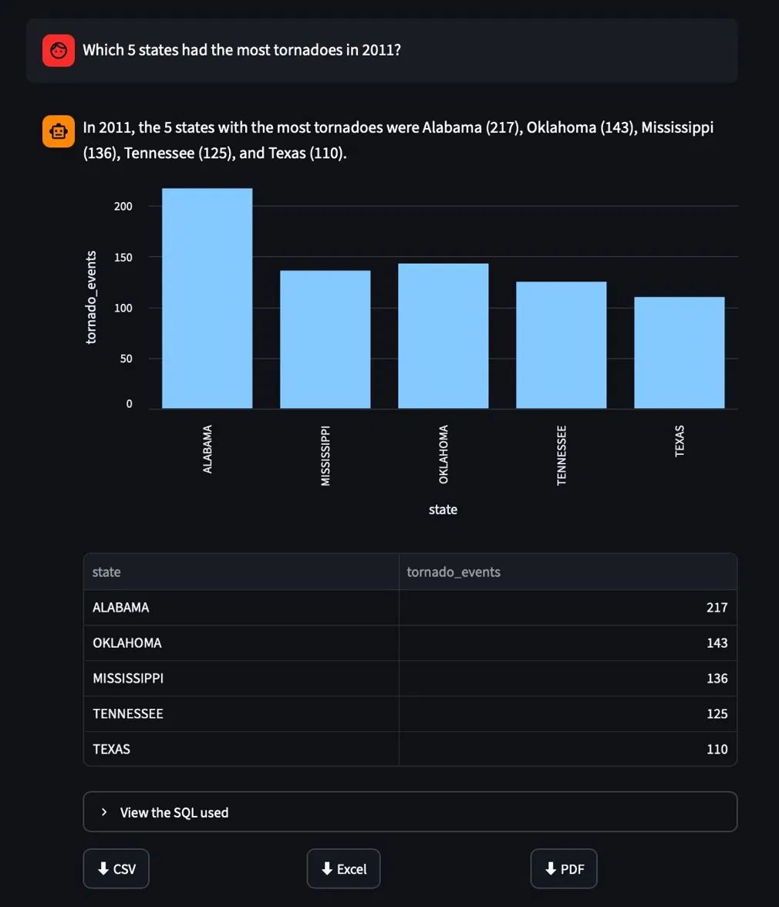
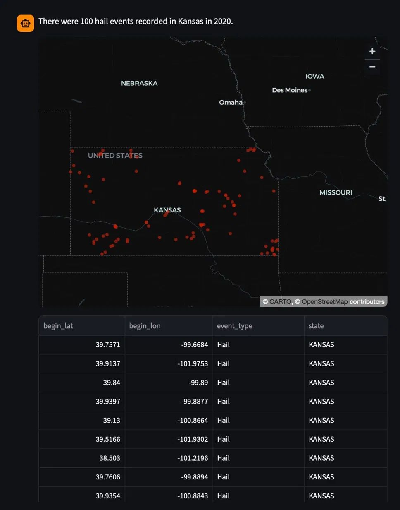
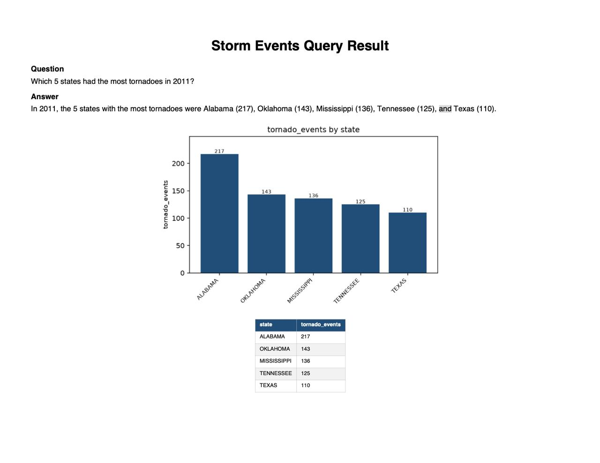
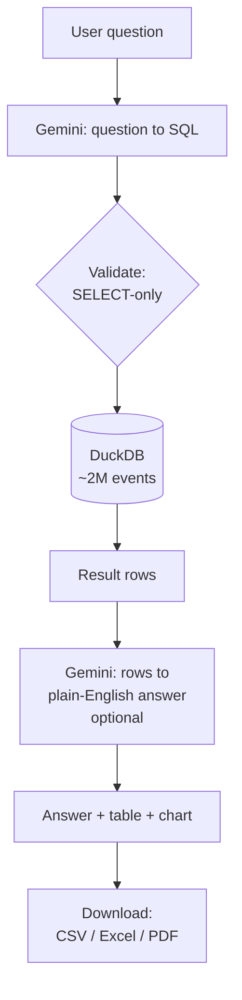

# StormQuery: Text-to-SQL Q&A Chatbot


*Ask 76 years of U.S. severe-weather data in plain English — and get answers backed by SQL, with charts and downloadable reports.*

StormQuery is a natural-language chatbot over the [NOAA Storm Events Database](https://www.ncei.noaa.gov/stormevents/) (~2 million events, 1950–2026). You ask a question in English; it translates that question into SQL, runs it against a local database, and returns an accurate, verifiable answer — with an automatic chart or map and one-click export to CSV, Excel, or PDF.

Unlike a typical "chat with your data" tool built on semantic search, StormQuery uses a **text-to-SQL** approach: the language model writes a query and a real database computes the answer. This makes aggregations (counts, sums, rankings) *exact and verifiable* rather than approximate.

---

## Demo

**Ranking question with an automatic bar chart**



**Map question — events plotted by location**



**Downloadable PDF report (chart embedded, SQL excluded)**



---

## Features

- **Natural-language questions** answered over ~2M storm events.
- **Text-to-SQL engine** with a **self-correction loop** — a failed query is retried using the database's own error message.
- **Verifiable answers** — the generated SQL is shown for every response.
- **Automatic visualizations** — a map for location results, a bar chart for rankings and trends, a table otherwise.
- **Downloadable reports** — CSV (raw data), Excel (styled), and PDF (a formatted report with the chart embedded).
- **Safety guardrails** — a read-only database connection *and* a SELECT-only query validator (two independent layers).
- **Data-aware** — the model is instructed to flag the 1996 record-completeness boundary (see [Data](#data)).
- **Automatic model fallback** — if one Gemini model runs out of quota or is unavailable, the engine tries the next one from a configurable list (see [Configuration](#configuration)).
- **Tested and benchmarked** — 71 automated tests (run on every push by GitHub Actions) and a 36-question benchmark that compares generated SQL against verified reference SQL (see [Testing](#testing) and [Evaluation](#evaluation)).

---

## How it works



1. The question is sent to Google Gemini together with a **schema context** (exact column names, the valid `event_type` strings, example queries, and data rules).
2. Gemini returns a SQL query, which is **validated** to be read-only.
3. The query runs against a local **DuckDB** database, computing the exact result.
4. The result rows are **summarized** by Gemini into a plain-English answer (optional — can be switched off to use one API request per question).
5. The answer is shown with an automatic chart and export buttons.

---

## Design decisions

- **Text-to-SQL over retrieval (RAG).** Most questions are aggregations. Semantic search retrieves *similar* rows but cannot return the *complete* set a COUNT or SUM needs, and language models are unreliable at arithmetic over many rows. Translating to SQL makes the answer exact and checkable.
- **DuckDB.** A columnar, in-process analytical database — purpose-built for aggregation queries, with no server to manage. Faster than SQLite on wide-table analytics, and far simpler than PostgreSQL for a read-only, single-user workload.
- **Accuracy comes from grounding.** The model is given the exact event-type values, state casing, example queries, and the 1996 rule — so correctness depends mostly on the supplied context, not on using the largest model.

---

## Tech stack

**Python** · **DuckDB** · **Google Gemini** (`google-genai`) · **Streamlit** · pandas · matplotlib · ReportLab · openpyxl · python-dotenv

---

## Project structure

| File | Purpose |
|------|---------|
| `build_database.py` | Downloads NOAA data, cleans it, builds the DuckDB database + schema context. |
| `slim_database.py` | Optional deployment step: drops the large narrative columns to shrink the database and regenerates the schema context. |
| `engine.py` | Text-to-SQL engine: question to SQL to execute to answer, with guardrails, self-correction and model fallback. |
| `visuals.py` | Chooses and renders the right visualization (map / bar chart). |
| `exporters.py` | CSV / Excel / PDF export. |
| `app.py` | Streamlit chat interface. |
| `schema_context.md` | Auto-generated schema + value lists that ground the model. |
| `requirements.txt` | Python dependencies. |
| `tests/` | pytest suite (71 tests) — Gemini is mocked, so no API key is needed. |
| `benchmark/` | Evaluation harness: `questions.py` (questions + reference SQL) and `run_benchmark.py`; reports are saved in `benchmark/results/`. |
| `.github/workflows/tests.yml` | CI: runs the tests on every push and pull request. |

---

## Setup

**Prerequisites:** Python 3.10+ and a free [Google Gemini API key](https://aistudio.google.com/app/apikey).

```bash
# 1. Clone and enter the project
git clone https://github.com/akhilsai007/StormQuery-Text-to-SQL-Q-A-Chatbot.git
cd StormQuery-Text-to-SQL-Q-A-Chatbot

# 2. Create and activate a virtual environment
python3 -m venv venv
source venv/bin/activate          # Windows: venv\Scripts\activate

# 3. Install dependencies
pip install -r requirements.txt

# 4. Build the database (downloads ~76 yearly files from NOAA; one-time, ~5-15 min)
python build_database.py

# 5. Add your API key (see .env.example)
echo "GEMINI_API_KEY=your_key_here" > .env

# 6. Run
streamlit run app.py
```

> **Note:** the database (`storm_events.duckdb`, several hundred MB) is **not** committed to the repo — step 4 builds it from NOAA's public data. For a hosted deployment, set `DB_URL` in `app.py` to a downloadable copy of the database (the app fetches it on first start).

---

## Configuration

Optional settings in `.env` (no code changes needed):

```bash
GEMINI_API_KEY=your_key_here
# Preferred model first, then fallbacks. Used when a model hits its quota or is unavailable.
STORMQUERY_MODELS=gemini-flash-lite-latest,gemini-flash-latest
# Set to 0 to skip the written-summary call: 1 API request per question instead of 2.
STORMQUERY_SUMMARIZE=1
```

Free-tier Gemini limits differ by model and change over time — check your own limits at [ai.dev/rate-limit](https://ai.dev/rate-limit). Without these settings the engine uses `DEFAULT_MODEL` in `engine.py`.

---

## Usage

Ask questions in plain English, for example:

- "How many tornadoes hit Texas in 2011?"
- "Which 5 states had the most hail events since 2015?"
- "What was the total property damage from hurricanes in 2005?"
- "Map all tornadoes in Oklahoma in 1999."

---

## Testing

```bash
pip install pytest
pytest -q          # 71 tests, no API key needed (Gemini is mocked)
```

The suite covers the SQL validator (injection and unsafe statements), the full question-to-answer pipeline with a mocked model (self-correction, retry limits, rate limits, fallback, row cap, empty and NULL results), NOAA damage/date parsing, chart selection, and CSV/Excel/PDF exports. GitHub Actions runs it on every push.

---

## Evaluation

A 36-question benchmark (8 easy, 10 medium, 8 hard, 6 edge-case, 4 unanswerable) plus 12 unsafe-SQL checks and 3 adversarial prompts. For each question the generated SQL and a verified reference SQL are executed on the same database and their results compared.

Run on 25 Nov 2026 with `gemini-flash-lite-latest` (summaries off, so this measures SQL correctness, not answer wording):

| Metric | Result |
|---|---|
| Exact-match accuracy | 30 / 32 answerable questions |
| Accuracy allowing extra columns | 32 / 32 |
| Valid-SQL rate (query executed) | 32 / 32 |
| Self-correction | 1 question needed a retry; recovered and correct |
| Unanswerable questions declined | 4 / 4 |
| Unsafe SQL statements blocked | 12 / 12 |
| Adversarial prompts handled safely | 3 / 3 (database unchanged) |
| Latency, SQL generation (avg / median / p95) | 2.8 s / 1.6 s / 5.7 s |
| Tokens | ~97k in / ~1.3k out across 39 requests |

**Read these results with care.** The benchmark is small and was written by the project author, including the reference SQL. Four questions (tornadoes in Texas 2011, hurricane damage 2005, hail since 2015, floods per year since 2000) resemble example queries in the model's prompt. `-latest` model names can change over time. Treat the numbers as a regression check, not a general accuracy claim.

```bash
python benchmark/run_benchmark.py --dry-run          # reference SQL only, no API calls
python benchmark/run_benchmark.py --model <model>    # full run; writes a report to benchmark/results/
```

---

## Data

Source: [NOAA NCEI Storm Events Database](https://www.ncei.noaa.gov/stormevents/) (1950–2026).

**Record-completeness note:** only tornado, hail, and thunderstorm-wind events are recorded before 1996; all ~50 event types are recorded from 1996 onward. The model is instructed to flag this when a question spans that boundary, so a count of zero before 1996 isn't misread as "no events".

---

## Limitations & future work

- Free-tier Gemini quotas are small (per-model daily and per-minute caps), which limits how many questions can be asked; the fallback list softens this but cannot remove it.
- Each question is answered independently — there is no conversation memory for follow-ups like "what about Oklahoma?".
- The benchmark is small and self-authored (see [Evaluation](#evaluation)).
- The in-app map is interactive; the PDF map is a coordinate scatter (avoids heavy geospatial dependencies).
- Descriptive/narrative questions are not the focus — a future hybrid could add retrieval over the event narratives.

**Possible next steps:** conversation memory; a larger independent benchmark (150–200 questions); an "interpretation line" showing how the question was understood; line charts for trends; retrieval (RAG) over event narratives; county-level geospatial analysis; stricter SQL validation with an SQL parser.

---

## Acknowledgements

Built as a Master's capstone project. Data courtesy of NOAA's National Centers for Environmental Information.
